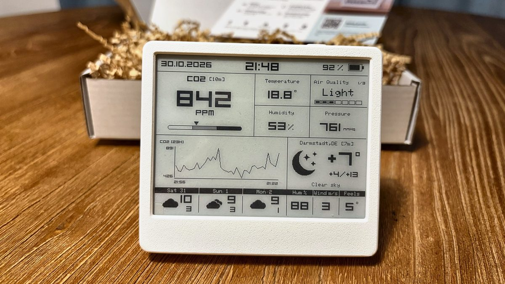

# Smart Meteo

A battery-powered indoor climate monitor with a 4.2" e-ink screen. It measures CO₂, temperature,
humidity, pressure and air quality, keeps its own history on the device, and talks to Home
Assistant over MQTT, to a smart home over Matter (Thread), or just to your Wi-Fi.



**Status:** working prototype. Nothing is for sale. This repository is the firmware and the
enclosure as they run on the prototypes.

## What's inside

| Part | What it does |
|---|---|
| ESP32-C6 (ESP32-C6-WROOM-1, 8 MB flash) | Wi-Fi, Thread / Matter, deep sleep between measurements |
| Sensirion SCD41 | CO₂ (photoacoustic, real CO₂ — not an estimate), temperature, humidity |
| Bosch BME690 | pressure and gas; with Bosch BSEC, an indoor-air-quality index (see below) |
| Good Display GDEY042T81, 4.2" e-ink | 400×300, keeps the picture with the power off |
| Li-Po cell, TP4056 charger, USB-C | months between charges at the default settings |

## What it does

- **Screen:** CO₂ with a scale, temperature and humidity, air quality, pressure or a barometric
  rain / storm warning, a CO₂ graph, a three-day forecast and the outdoor weather.
- **Local web console** served by the device: settings, live readings, history graphs and CSV
  export, calibration, firmware updates. It is password-protected, and every unit draws its own
  random password, shown on its screen together with a Wi-Fi QR code. There is no shared default.
- **Three ways to connect**, chosen in the console:
  - **Wi-Fi** — the device fetches its own weather (MET Norway, no account needed; or
    OpenWeatherMap with your key) and can send alerts to Telegram;
  - **Wi-Fi + MQTT** — Home Assistant discovery, retained state, alerts as events, and weather
    from Home Assistant; the console writes a ready-made automation for you;
  - **Matter over Thread** — CO₂, air quality, temperature and humidity in Apple Home, Google
    Home and others. It runs on Matter **test credentials**, so apps will call it an
    "uncertified device".
- **Alerts:** stuffy air (CO₂ above your level), polluted air, and damp judged at the coldest wall
  rather than in the room.
- **History stays on the device:** about a year and a half at the default 15-minute step.
- **No cloud in the data path.** The device makes outgoing requests only for weather (if it
  fetches its own), for city search during setup, and once a day to check for signed firmware
  updates (that can be turned off).

## Bosch BSEC — the one closed part

The air-quality index comes from Bosch's BSEC library. Its licence allows the compiled library
inside a product, but not passing the library, its headers or its configuration on. So they are
**not in this repository**.

The firmware builds and runs without BSEC: everything works except the index, and the screen,
console, Telegram and Home Assistant say "No air-quality index" instead of pretending to warm up.
Pressure and the rain forecast still work. To build with the index, get BSEC 3.3 from Bosch and
follow [`firmware/components/bsec2/README.md`](firmware/components/bsec2/README.md). Bosch's
terms are written for business users; read them before you do.

## Building

You need [ESP-IDF v5.5.2](https://docs.espressif.com/projects/esp-idf/en/v5.5.2/esp32c6/get-started/)
and [esp-matter](https://github.com/espressif/esp-matter) (the firmware is one image with Wi-Fi
and Matter, and the build stops without esp-matter's environment).

```bash
. $HOME/esp/v5.5.2/esp-idf/export.sh
. $HOME/esp/esp-matter/export.sh
cd firmware
idf.py build
```

The first build compiles Matter and takes a while. On a machine with little memory, cap the
parallel jobs: esp-matter starts its own build of the Matter SDK inside the main one.

### Signing and flashing

The firmware only accepts signed images (ECDSA, Secure Boot V2 scheme, verified by the running
app; hardware Secure Boot is not enabled). A build is not signed by itself. Make your own key once:

```bash
espsecure.py generate_signing_key --version 2 --scheme ecdsa256 ~/my-smartmeteo-key.pem
```

Then build, sign and flash over USB in one step:

```bash
cd firmware
SMARTMETEO_SIGNING_KEY=~/my-smartmeteo-key.pem tools/flash.sh --full
```

After that, your device accepts updates signed with **your** key. Official updates are signed
with ours and will not install on it — turn off automatic updates in the console
(System → Firmware updates → Automatic updates) so it does not download them.

### Tests

`firmware/tests/run.sh` builds the firmware's own sources on your computer, without ESP-IDF or a
device: air-quality logic, weather parsing, the wake-up schedule, the screen against reference
frames, the console against the firmware. It needs `c++` and `python3`; the browser tests also
need Node.js and Playwright (see `firmware/tests/README.md`).

Some comments in the code, and most in the tests, are in Russian.

## Repository

| Folder | |
|---|---|
| `firmware/` | ESP-IDF project: `main/` is the firmware, `tests/` the host tests, `tools/` flashing, signing and diagnostics |
| `hardware/enclosure/` | the enclosure: Fusion 360 generator scripts, STEP and STL for PLA and resin printing |
| `hardware/board-v2/` | the board — schematic, layout and BOM to follow |
| `artwork/` | the scripts that turn the setup-screen picture and the logo into firmware data |
| `docs/` | photos and documentation (CC BY-SA 4.0) |

## Licences

- **Firmware and scripts:** Apache License 2.0 — [`LICENSE`](LICENSE).
- **Hardware** (enclosure, board): CERN Open Hardware Licence v2 — Permissive —
  [`LICENSES/CERN-OHL-P-2.0.txt`](LICENSES/CERN-OHL-P-2.0.txt).
- **Documentation and images:** Creative Commons Attribution-ShareAlike 4.0 —
  [`LICENSES/CC-BY-SA-4.0.txt`](LICENSES/CC-BY-SA-4.0.txt).
- **Third-party code and fonts:** see [`NOTICE.md`](NOTICE.md).

"Smart Meteo" and the Smart Meteo logo are the project's name and mark. The licences above cover
the code and the designs, not the name or the logo.

## Contact

hello@smartmeteo.org · <https://smartmeteo.org>

Security issues: please see [`SECURITY.md`](SECURITY.md).
