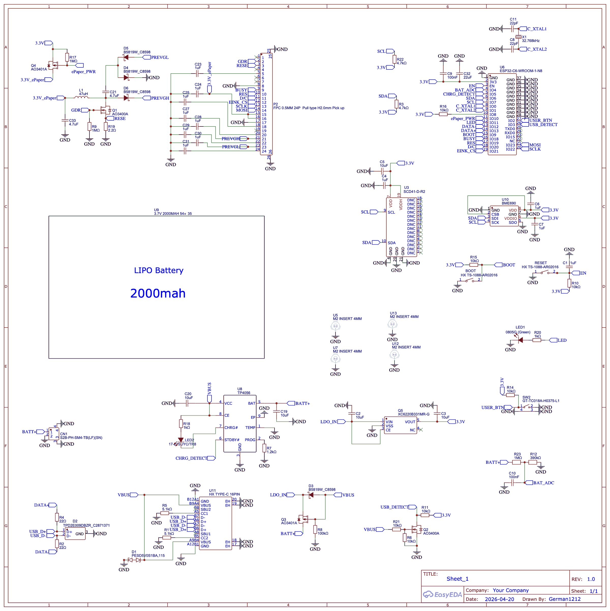

# Board v2 (silkscreen "SmartMeteo v2.2")

Two-layer board, about 92 × 78 mm, drawn in EasyEDA. Components on the top side; the e-ink panel
is glued to the flat bottom side and its ribbon wraps around the lower edge into P2.

| File | |
|---|---|
| [`SmartMeteo-v2.2_schematic.pdf`](SmartMeteo-v2.2_schematic.pdf) | schematic (one sheet) |
| [`SmartMeteo-v2.2_schematic.png`](SmartMeteo-v2.2_schematic.png) | the same as a picture |
| [`SmartMeteo-v2.2_BOM.csv`](SmartMeteo-v2.2_BOM.csv) | bill of materials with LCSC part numbers |
| [`SmartMeteo-v2.2_Gerber.zip`](SmartMeteo-v2.2_Gerber.zip) | Gerber and drill files |

## What's on it

- **ESP32-C6-WROOM-1-N8** (8 MB flash) with a 32.768 kHz crystal for the sleep clock.
- **Sensirion SCD41** (CO₂, T, RH) and **Bosch BME690** (pressure, gas) on I²C with 4.7 kΩ pull-ups.
- **E-ink panel** (Good Display GDEY042T81, 24-pin FPC) with its boost circuit (L1 47 µH, three
  B5819W, Q1). The panel supply is switched by a P-FET (Q4), gate pulled up by 1 MΩ, so an
  unpowered GPIO means "panel off".
- **TP4056** charger at 1 A (R7 1.2 kΩ), **XC6220** 3.3 V LDO, power path with Q3 and D3, USB-C
  with ESD protection on VBUS and on the data lines.
- **Battery voltage** on a 1 MΩ / 390 kΩ divider (0.1 %) with 100 nF into the ADC. It draws about
  3 µA all the time; a switch to remove that was judged not worth the part and the pin.
- One side-actuated user button (SW2), RESET and BOOT buttons, two LEDs (status and charge).

## Pins

| GPIO | Net | Use |
|---|---|---|
| 2 | USER_BTN | button, low = pressed, 10 kΩ pull-up; wakes from deep sleep |
| 3 | USB_DETECT | low = USB cable present (via Q2); wakes from deep sleep |
| 4 | BAT_ADC | battery divider |
| 5 | CHRG_DETECT | TP4056 **STDBY#** (pin 6): low when charging has finished. The firmware enables the internal pull-up only while USB is present |
| 6 / 7 | SDA / SCL | I²C |
| 10 | ePaper_PWR | panel supply, low = on |
| 11 | LED | status LED |
| 18 / 19 / 20 / 21 / 22 / 23 | BUSY / RES / D/C / EINK_CS / SCLK / MOSI | panel, SPI |
| 0 / 1 | C_XTAL1 / C_XTAL2 | 32.768 kHz crystal |

## Notes from building it

- **Battery:** the footprint is labelled 54 × 35 mm (a 103450 cell). Our v2 units run on a
  2000 mAh 804050 pouch. Use a cell **with its own protection board**; there is none on this PCB.
  The firmware stops at 3.30 V as a second line of defence, not as the only one.
- **BME690:** on two of our boards the pressure channel read full scale; on one of them,
  resoldering the sensor fixed it. Treat it gently and follow Bosch's reflow guidance.
- **Battery reading:** resistor and ADC tolerances add up to 1–2 % per board. The firmware keeps
  a per-board correction factor in NVS (`bat_cal`).
- **LEDs** are top-view parts; the enclosure's back cover turns their light out through the side
  wall.

Licensed under the CERN Open Hardware Licence v2 — Permissive
([`../../LICENSES/CERN-OHL-P-2.0.txt`](../../LICENSES/CERN-OHL-P-2.0.txt)).
